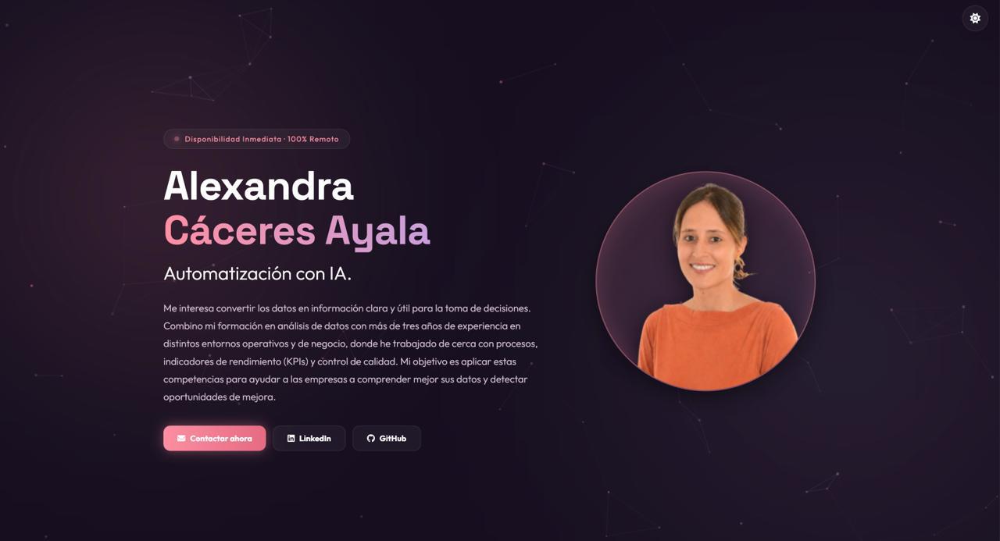
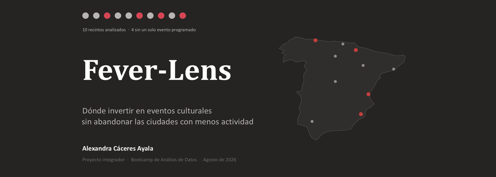
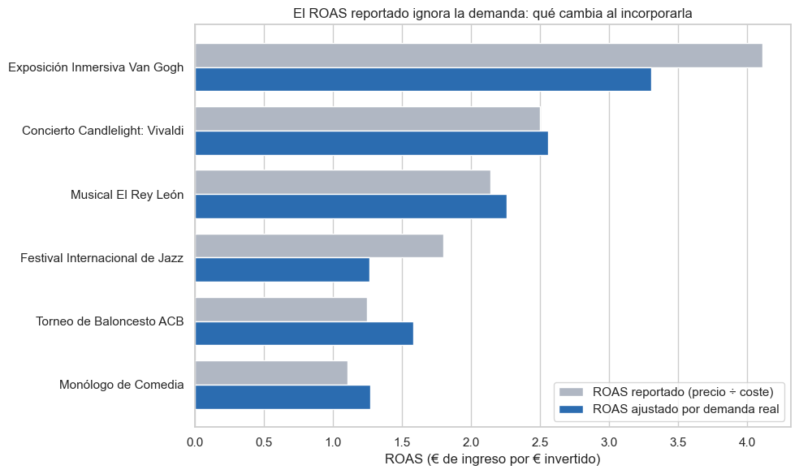
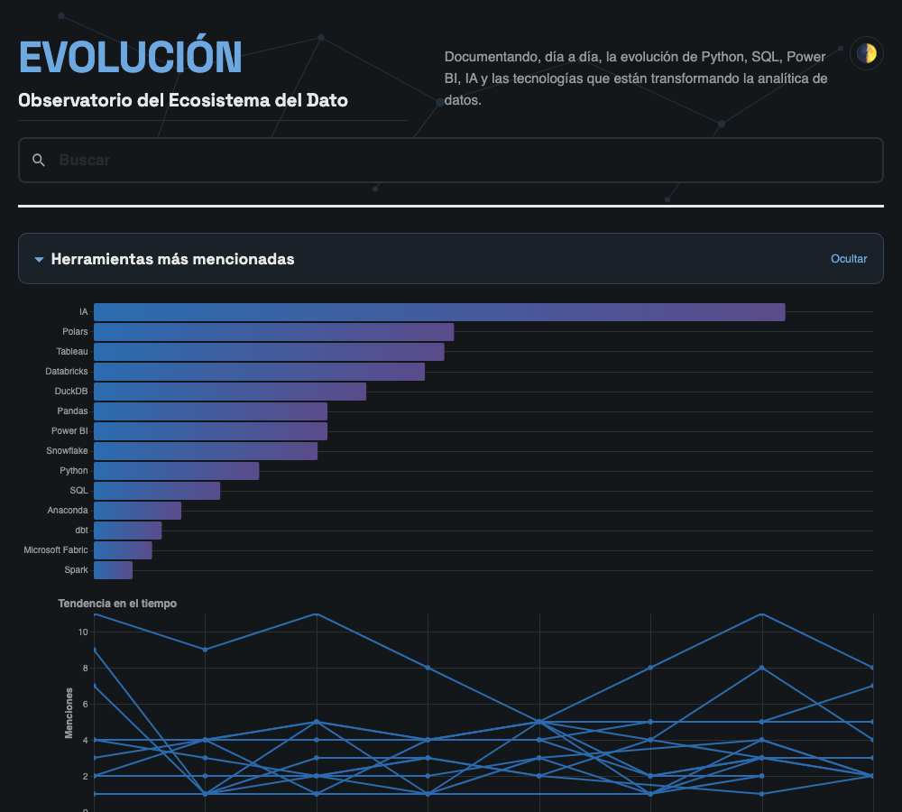
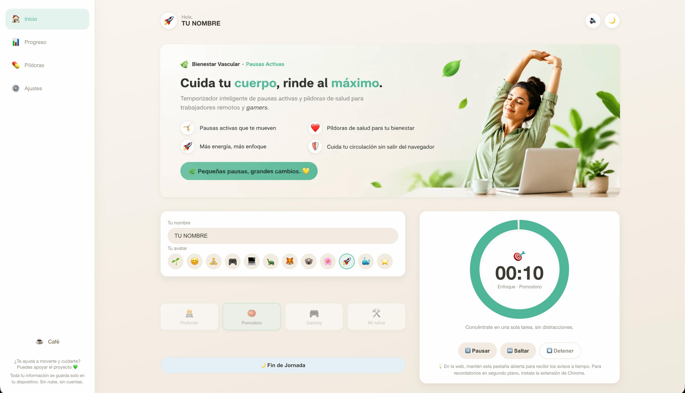
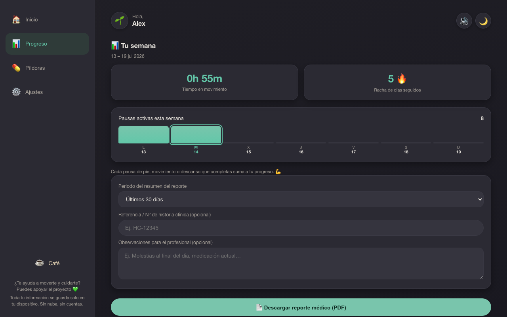

  <h1>📊 Alexandra Cáceres — Portafolio de Analítica de Datos</h1>
  

    
  

  
<em>Del dato crudo al dashboard, entendiendo el negocio detrás de cada métrica.</em>

  
  
  

 

## 👩🏻‍💻 Sobre este repositorio

Este repositorio aloja el código fuente de mi portafolio: el sitio donde presento mis proyectos de datos y mi trayectoria profesional.

Me interesa convertir los datos en información clara y útil para la toma de decisiones. Combino mi formación en análisis de datos con más de tres años de experiencia en distintos entornos operativos y de negocio, donde he trabajado de cerca con procesos, indicadores de rendimiento (KPIs) y control de calidad. Mi objetivo es aplicar estas competencias para ayudar a las empresas a comprender mejor sus datos y detectar oportunidades de mejora.

> **Estado:** Disponibilidad Inmediata · 100% Remoto 🌍

---

## 🛠️ Stack Técnico y Herramientas

**Análisis de datos**

**Flujo de trabajo**

---

## 🚀 Análisis en Acción

### 🎯 Fever-Lens · Inversión en Eventos Culturales

> **Estado:** Mejora continua — entregado como proyecto final del bootcamp (agosto 2026), lo sigo ampliando.

**[Informe completo (PDF)](https://alexandra-caceres-ayala.github.io/alexandra-caceres-portfolio/Fever_Lens_Informe.pdf)** · [Presentación (PDF)](https://alexandra-caceres-ayala.github.io/alexandra-caceres-portfolio/Fever_Lens_Presentacion.pdf) · [Métricas DAX (PDF)](https://alexandra-caceres-ayala.github.io/alexandra-caceres-portfolio/Fever_Lens_Metricas_DAX.pdf)

Análisis de punta a punta (agosto 2026) para decidir dónde invertir el presupuesto publicitario de eventos culturales sin abandonar las ciudades con recintos infrautilizados: de 10 recintos analizados, 4 no tienen un solo evento. Integré tres fuentes —catálogo en Google Sheets, 42,4 millones de interacciones de Kaggle y renta del INE— en un modelo en estrella en MySQL (7 tablas y una vista), analicé el embudo en Python y cerré con un dashboard en Power BI y métricas DAX.

Los cuatro hallazgos, verificados contra los datos:

- El ROAS del catálogo (precio ÷ coste) no contiene demanda: al corregirlo con la conversión real, **3 de 6 eventos cambian de puesto**.
- Cada evento se rompe en un punto distinto del embudo: el festival de jazz es el peor enganchando (4,74 %) y el mejor cerrando (80,8 %).
- De 08:00 a 13:00 se compra **2,26 veces más** que de 16:00 a 20:00.
- La renta no explica dónde hay oferta cultural (r = 0,535 · p = 0,111): mi hipótesis de partida era la contraria, y la descarté.

  
  

`Google Sheets` · `MySQL` · `Python` · `pandas` · `Power BI` · `DAX`

---

### 🔭 EVOLUCIÓN · Observatorio del Ecosistema del Dato

**[Ver la web](https://alexandra-caceres-ayala.github.io/evolucion/)** · [Caso de estudio](https://alexandra-caceres-ayala.github.io/alexandra-caceres-portfolio/caso-evolucion.html) · [Repositorio](https://github.com/Alexandra-Caceres-Ayala/evolucion) · [Newsletter semanal en LinkedIn](https://www.linkedin.com/build-relation/newsletter-follow?entityUrn=7485707534079672322)

Plataforma editorial que documenta a diario, en español, la evolución del ecosistema del dato. Funciona como un pipeline automatizado de extremo a extremo: cada mañana un agente de IA en modo desatendido redacta el boletín, lo sube mediante la API de GitHub y GitHub Actions reconstruye y publica el sitio en GitHub Pages, sin pasos manuales. El panel de menciones y tendencias por herramienta se genera con pandas y Altair, y el sitio incluye buscador, RSS y modo claro/oscuro.

Concebí el producto, defino su línea editorial y dirijo su desarrollo apoyándome en IA generativa.

  

`Markdown` · `Python` · `pandas` · `Altair` · `GitHub Actions` · `GitHub Pages` · `IA generativa`

---

### 🌿 Bienestar Vascular · Pausas Activas

**[Extensión en la Chrome Web Store](https://chromewebstore.google.com/detail/bienestar-vascular-%C2%B7-paus/bhgkbamkgopclojoicpfomlejjdjbjip)** · [App web](https://alexandra-caceres-ayala.github.io/bienestar-vascular-pausas-activas/) · [Repositorio](https://github.com/Alexandra-Caceres-Ayala/bienestar-vascular-pausas-activas)

Herramienta de pausas activas para quienes pasan el día frente a la pantalla, publicada y aprobada en la Chrome Web Store y disponible también como app web instalable. Registra la actividad diaria y las rachas, y exporta los datos en CSV/PDF para analizarlos después en Excel o Power BI. Toda la información se guarda solo en el dispositivo —sin cuentas ni servidores— y está disponible en español e inglés.

La concebí y la llevé a producción, apoyándome en IA generativa para la implementación del código.

  
  

`IA generativa` · `Local Storage API` · `Export CSV/PDF` · `Chrome Web Store`

---

## 🧩 Cómo está construido este portafolio

Sitio estático en HTML, CSS y JavaScript, con Chart.js para el radar de proyectos y tsParticles para el fondo animado, publicado en GitHub Pages. Los proyectos se definen en una única lista dentro del código, que genera automáticamente el filtro, el radar y los iconos del stack. Construido apoyándome en IA generativa.

## 💼 ¡Conectemos!

Siempre estoy abierta a conversar sobre nuevas oportunidades, proyectos de datos o sobre cómo optimizar los procesos de tu negocio a través de la analítica.

- 📧 **Envíame un correo:** [alexandraaca7@gmail.com](mailto:alexandraaca7@gmail.com)
- 👔 **Conéctate conmigo en LinkedIn:** [Alexandra Cáceres Ayala](https://linkedin.com/in/alexandra-caceres-ayala)
